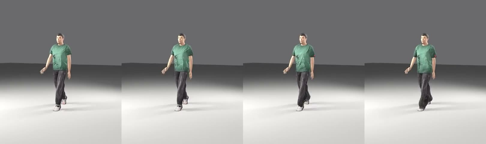
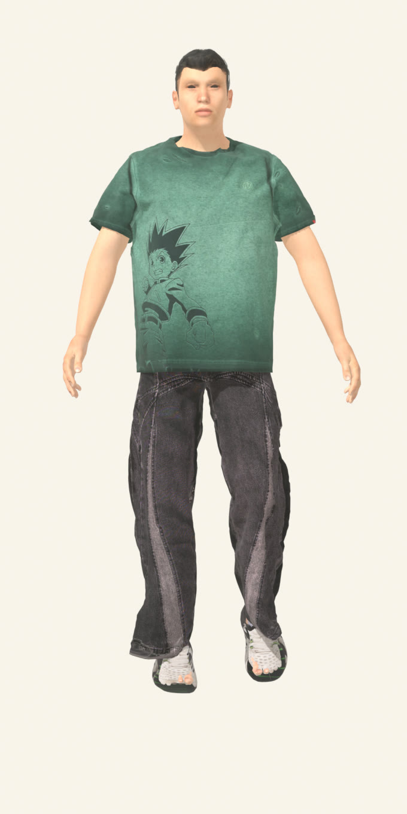
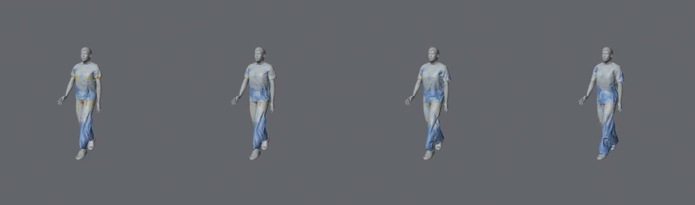

<div align="center">

# FIT-AH

**Never buy the wrong size again.**
See every size on your own 3D body, before you pay.



</div>

---

## What is Fit-Ah?

Sizes are different for every brand. An M from one shop can fit like an L from another, so people buy, try, and send it back.

Fit-Ah fixes that. You scan your body once from **one photo + your height**. Then, for any piece of clothing with a size chart, Fit-Ah compares it with your body and tells you which size to pick and how much room each size gives you.

## Features

| | Feature | How it works |
|---|---|---|
| 📸 | **Body scan from one photo** | Upload a front photo and type your height. [MediaPipe Pose](https://ai.google.dev/edge/mediapipe/solutions/vision/pose_landmarker) finds 33 body points **in your browser** and works out your chest, waist and shoulders. |
| 🧍 | **Your 3D body** | Your measurements shape a 3D body you can turn around and fine-tune with sliders. |
| 📏 | **Size recommendations** | Each piece in your wardrobe keeps the brand's real size chart. Fit-Ah compares it with your measurements and tells you which size fits and why. |
| ✂️ | **Wardrobe with automatic cut-outs** | Snap a photo of a piece you own. The background is removed in your browser and the item is saved with its size chart. |
| 🌦️ | **AI stylist** | Fit-Ah checks the live weather where you are, then Google Gemini suggests 3 outfits for your shirt: bottoms, shoes, and why they work. |

<table>
<tr>
<td width="33%"></td>
<td></td>
</tr>
<tr>
<td align="center"><sub>Body scan: the 33 points MediaPipe finds</sub></td>
<td align="center"><sub>Fit map: Shirt S · Jeans M → Shirt XL · Jeans XL, same body</sub></td>
</tr>
</table>

### Coming next: Fit Lab

Every size as a real **cloth simulation** on your body: the same shirt in S, M, L and XL side by side, a **fit map** that shows where the fabric pulls (red is tight, blue is loose, white is just touching), and a catwalk so you can see it move.
The videos on the login page are made this way in Blender (shirt over jeans, with real collision). Fit Lab is still in development and is not in this repo yet.

## Try it

Open the app, go to the login page and press **Auto-fill Credentials** to sign in with the demo account. It comes with a sample wardrobe so you can explore straight away.

## Tech stack

| Part | What we use |
|---|---|
| App | [Next.js 16](https://nextjs.org) (App Router), React 19, TypeScript |
| Styling | Tailwind CSS, Framer Motion |
| 3D | [three.js](https://threejs.org), React Three Fiber + drei, Draco-compressed glTF models |
| Body scan | MediaPipe Tasks Vision (Pose Landmarker), runs in the browser |
| Background removal | [@imgly/background-removal](https://github.com/imgly/background-removal-js), runs in the browser |
| Accounts and data | Firebase Authentication, Firestore, Storage |
| AI stylist | Google Gemini (called from a server route, so the key is never sent to the browser) |
| Weather | OpenWeather API |
| 3D content | Blender (cloth simulation, model export) |

## Run it yourself

You need **Node.js 20 or newer**, a **Firebase** project, a **Gemini** API key and an **OpenWeather** API key.

```bash
git clone https://github.com/Bn0717/Fit-ah.git
cd Fit-ah
npm install
```

Create a file called `.env.local` in the project folder:

```bash
# Firebase (Project settings → Your apps → Web app)
NEXT_PUBLIC_FIREBASE_API_KEY=
NEXT_PUBLIC_FIREBASE_AUTH_DOMAIN=
NEXT_PUBLIC_FIREBASE_PROJECT_ID=
NEXT_PUBLIC_FIREBASE_STORAGE_BUCKET=
NEXT_PUBLIC_FIREBASE_MESSAGING_SENDER_ID=
NEXT_PUBLIC_FIREBASE_APP_ID=

# Server only (never exposed to the browser)
GEMINI_API_KEY=
OPENWEATHER_API_KEY=
```

In Firebase, turn on **Authentication** (Email/Password and Google), **Firestore** and **Storage**. Then start the app:

```bash
npm run dev
```

Open [http://localhost:3000](http://localhost:3000).

## Pages

| Page | What it's for |
|---|---|
| `/login` | Landing and sign-in: a scroll story with the 3D model, features, wardrobe and sign-in |
| `/signup` | Create an account |
| `/onboarding` | First-time setup: your info, body scan, then your 3D body |
| `/profile` | Your 3D body, measurements and sliders |
| `/items` | Your wardrobe: add pieces, size charts, fit recommendations and AI outfit ideas |
| `/dashboard` | Overview of your profile and tips |

## Project structure

```
app/                 pages (one folder per page) and API routes
  api/gemini/        server route that calls Gemini
  api/weather/       server route that calls OpenWeather
components/          UI pieces (login, items, profile, navbar)
lib/
  firebase/          sign-in, database and file storage
  mediapipe/         body scan (pose detection → measurements)
  fitEngine/         size and fit calculations
  utils/             measurements, image processing, 3D shirt scene
public/              images, videos and 3D models
scripts/, blender/   scripts that made the login page content
```

## Feedback

Questions or ideas? Open an issue on this repo.
